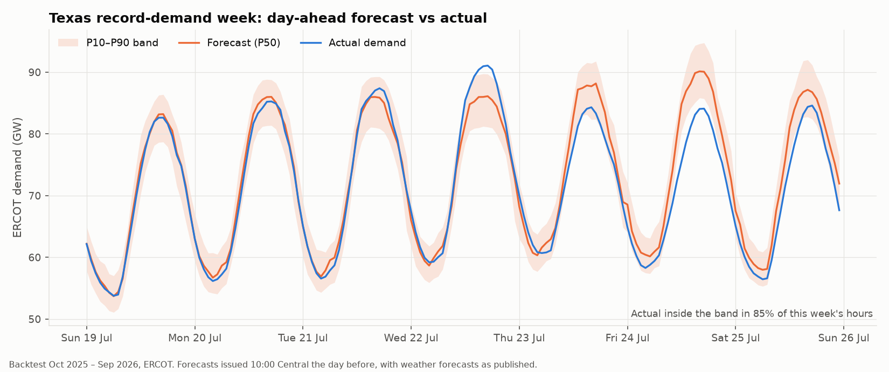
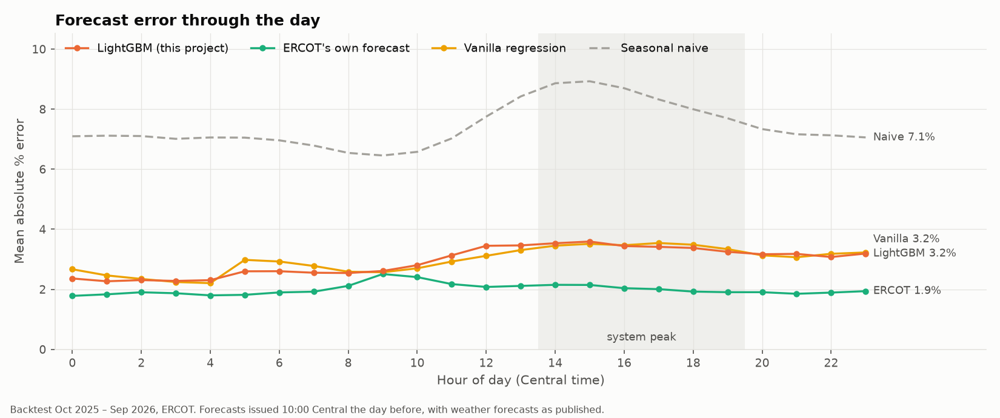
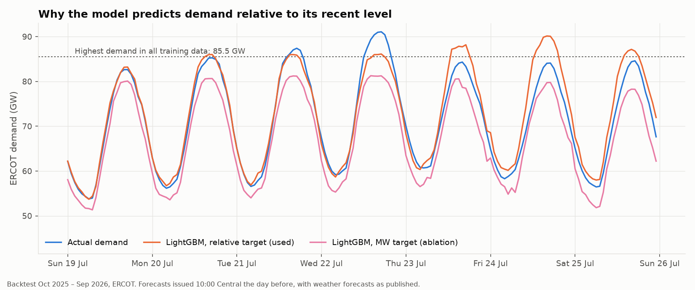

# Day-ahead electricity demand forecasting for Texas (ERCOT)

Every morning at 10:00, forecast tomorrow's demand on the Texas grid hour by hour, as a
range rather than a single line, using only public data. Then check the forecast honestly
against a full year it never saw.

## Results at a glance

Twelve months, October 2025 to September 2026, 8,760 hourly forecasts per model. Each was
made at 10:00 Central the day before, with weather **forecasts as they were published that
morning**.

| Model | Typical error (MAPE) | MASE | Error on the daily peak | P10–P90 band holds |
|---|---:|---:|---:|---:|
| Same hour last week (seasonal naive) | 7.42% | 0.92 | 8.55% | — |
| Classical regression (GEFCom benchmark) | 2.97% | 0.39 | 3.68% | — |
| **LightGBM with calibrated band (this project)** | **2.94%** | **0.38** | **3.27%** | **78.4%** |
| ERCOT's own published forecast | 2.00% | 0.25 | 2.02% | — |



**What this means for a client**

- **59% less error than "same as last week".** Typical hourly error falls from 7.4% to 2.9% of
  demand. The model also beats the standard regression benchmark, though only narrowly.
- **A range you can plan on.** Over the year the P10–P90 band held 78% of actual hours, close to
  the 80% it promises. It does slip month to month: it held only 52% in September 2026, when
  demand fell after a record August.
- **It is not better than the grid operator.** ERCOT's own forecast is a point more accurate
  (2.0%). This model's errors are largest in rare freezes (6% below 0 °C) and on the record day
  itself (forecast peak 86 GW against 91 GW actual). It is a strong, transparent forecast built
  from public data, not a replacement for ERCOT's.



---

## How it works

**Data** (all free; details and licences in [`data/README.md`](data/README.md)):

- **Demand:** hourly ERCOT demand and ERCOT's published day-ahead forecast, from EIA-930.
- **Weather:** measured temperature from five airport stations (NOAA GHCNh), weighted by city
  population, plus archived GFS weather forecasts (Open-Meteo).
- **Holidays:** the `holidays` package.
- **Window:** July 2021 onward, deliberately after Winter Storm Uri, when load shedding made
  recorded demand meaningless.

**Models**, all scored on the same rolling backtest and retrained every month:

1. **Seasonal naive**: same hour last week.
2. **Vanilla regression**: the GEFCom2012 reference model. It uses temperature and the calendar,
   with no recent demand.
3. **LightGBM**: recent demand, weather, calendar and holiday features. It predicts demand
   *relative to its 4-week level*, so it can forecast above anything in its training data.
   Three quantile models give P10/P50/P90, and conformal calibration on the previous 28 days
   corrects the band's width.
4. **ERCOT's published forecast**, as an external benchmark, never as an input.

**Why the numbers can be trusted:**

- **No future data, structurally.** Every input is built from data strictly before the 10:00
  issue time. A test replaces everything after that moment with noise and requires identical
  inputs. Two more tests plant realistic leaks (demand at the target hour, and a weather forecast
  that had not been published yet) and require them to be caught.
- **"Same hour yesterday" is refused.** At 10:00, yesterday's evening hours have happened but
  today's have not. Using them is the most common leak in load-forecasting notebooks.
- **Weather as it was forecast, not as it happened.** Each target hour uses the freshest GFS
  run that had *finished* before 10:00. Forecasts are bias-corrected against the airports using
  only the 28 days before. Results with measured weather (2.36% MAPE) are reported separately,
  as an upper bound.
- **No tuning on the test year.** Hyperparameters were fixed in advance, and design choices
  were made on synthetic data (see [`docs/decisions.md`](docs/decisions.md)).

## What the backtest shows

The full analysis is in [`docs/analysis.md`](docs/analysis.md). In short:

- **Growth broke the obvious model.** Summer 2026 set a Texas record (91.1 GW), 6 GW above
  anything in training. A LightGBM fitted on megawatts ran 1.9 GW low all summer. Predicting
  relative demand fixed it: 1.58% error in the 174 hours above 86 GW, against 3.27%.
  
- **The raw quantile band covered only 44% of hours.** The models learn from measured weather
  and never see a forecast miss. Conformal calibration on recent forecast-weather days lifted
  coverage to 78%.
- **Weather forecast error costs 0.6 points.** With perfect weather the same model scores 2.29%.
- **Holidays are not a weak spot** (2.7% against 3.0% on ordinary weekdays). Cold snaps, the
  afternoon peak and the September drop are.

## Limitations

- **One region, one test year.** Twelve monthly retrains on a single grid. A different year or
  grid could rank the models differently.
- **Five airports stand in for Texas weather.** They are weighted by city population, not by
  load. Station readings and grid forecasts differ by about 1 °C before correction.
- **ERCOT's publication time is not in the data.** EIA-930 records ERCOT's forecast but not
  when it was issued, so that comparison is "same day-ahead horizon", not "same minute".
- **Extreme cold is under-represented.** Excluding Uri keeps the data honest but leaves few
  freezing hours, and the model is weakest there.
- **The band is calibrated on average, not every month.** Monthly coverage ranged from 52% to
  94%, and conformal guarantees assume data that behaves the same over time, which hourly load
  does not.
- **Week-ahead is a note, not a result.** Naive degrades only slightly at two weeks (7.9%), but an
  honest week-ahead model needs archived 6–7-day weather forecasts, which are not included.

## Reproduce

Needs Python 3.12 or newer.

```bash
python -m venv .venv
```

```bash
.venv/Scripts/activate        # macOS/Linux: source .venv/bin/activate
```

```bash
pip install -e ".[dev]"
```

Copy `.env.example` to `.env` and add a free [EIA API key](https://www.eia.gov/opendata/register.php),
then:

```bash
python src/data_download.py && python src/backtest.py
```

The download takes a few minutes (about 50 MB, cached under the git-ignored `data/`), and the
backtest about 10 minutes. Everything is pinned and seeded, so it rewrites `results/*.csv` and
`reports/figures/*.png` unchanged. To redraw tables and figures without refitting:
`python src/backtest.py --from-predictions`.

The walkthrough notebook is [`notebooks/forecasting_walkthrough.ipynb`](notebooks/forecasting_walkthrough.ipynb),
generated by `python notebooks/build_walkthrough_notebook.py` (needs the `notebooks` extra).

## Tests

```bash
pytest -v
```

70 tests, under a minute, all offline on seeded synthetic data. The ones that matter most are in
`tests/test_leakage.py` and `tests/test_backtest.py`: they prove no input uses information after
the issue time, that no model trains on labels from after it, and that each check fails when a
leak is planted.

## Repository layout

```
src/
  config.py          every fixed choice: region, window, issue time, cities, seeds
  data_download.py   EIA + NOAA + Open-Meteo, cached, into one hourly table
  features.py        the leakage barrier, weather as known at issue time
  models.py          seasonal naive, vanilla regression, LightGBM quantile + conformal, ERCOT
  metrics.py         MAPE, MASE, peak errors, pinball loss, coverage, breakdowns
  backtest.py        rolling-origin engine; writes results/ and reports/figures/
  plots.py           figures
  synthetic.py       seeded test data
docs/                analysis.md (findings), decisions.md (why each choice)
results/             summary and breakdown tables (tracked)
reports/figures/     README and portfolio figures (tracked)
```

## License

MIT for the code; see `LICENSE`. Data keeps its own terms (EIA and NOAA are public domain;
Open-Meteo is CC BY 4.0); see [`data/README.md`](data/README.md).
